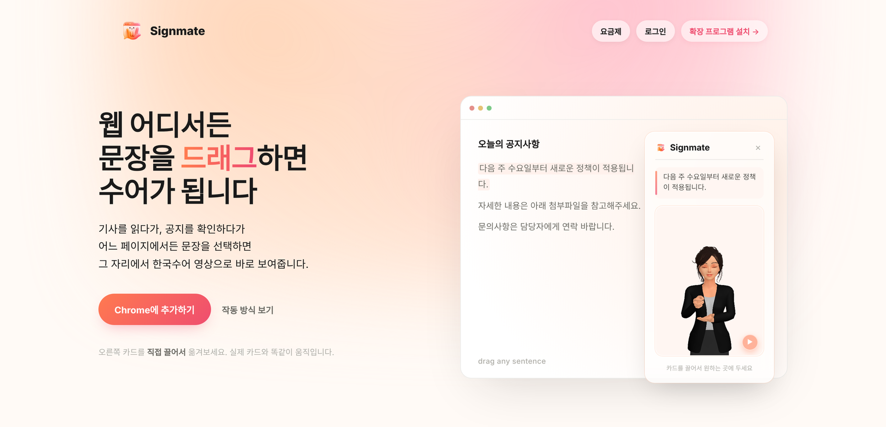
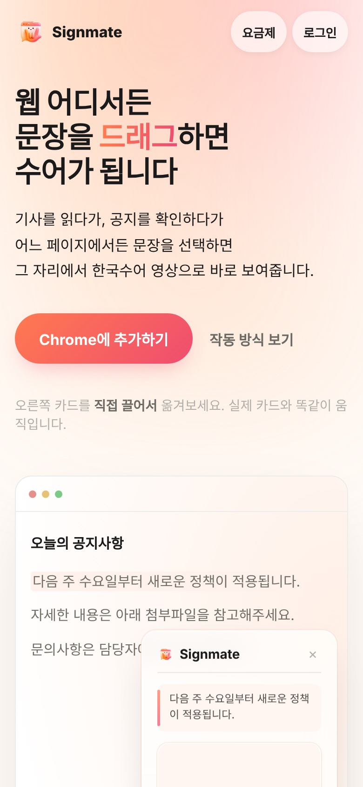
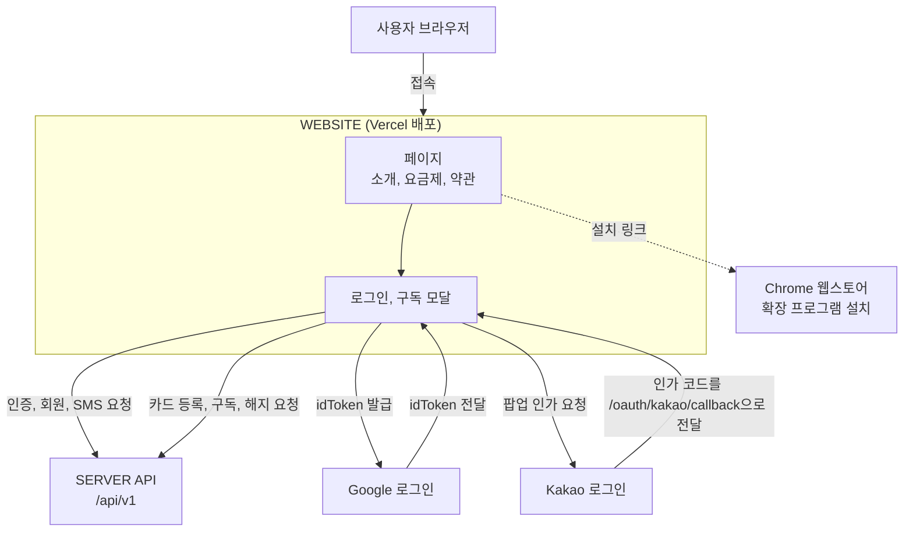

<div align="center">
  

  <h3><b>Signmate를 소개하고 가입과 구독을 맡는 공식 웹사이트</b></h3>

  
  
  
  
  
  
</div>

<br />

---

## 🧭 프로젝트 개요

Signmate는 웹에 있는 한국어 텍스트를 3D 아바타가 한국수어로 보여주는 서비스입니다.
청각장애인이 글로 된 정보를 수어로도 이해할 수 있도록 돕습니다.

이 레포(`WEBSITE`)는 서비스 소개와 가입, 구독을 담당하는 웹사이트입니다.
방문자는 서비스를 알아보고 크롬 웹스토어에서 확장 프로그램을 설치할 수 있습니다.
계정을 만들고 요금제를 구독하며 결제 내역을 확인하는 일도 이 사이트에서 처리합니다.

> 로그인과 구독이 별도 페이지 이동 없이 모달로 동작하는 점이 특징입니다.

<br />

<div align="center">
  
  &nbsp;&nbsp;
  
  <br />
  <sub>PC와 모바일 화면</sub>
</div>

<br />

---

## 🏗 시스템 아키텍처

<div align="center">
  
</div>

### 웹사이트 관점



<br />

---

## ✨ 주요 기능

### 페이지

| 경로 | 설명 |
| --- | --- |
| **`/`** | 서비스 소개 랜딩 페이지입니다. |
| **`/pricing`** | 요금제와 구독 시작 화면입니다. |
| **`/terms`** | 이용약관 페이지입니다. |
| **`/privacy`** | 개인정보 처리방침 페이지입니다. |
| **`/refund-policy`** | 환불 정책 페이지입니다. |
| **`/account-deletion`** | 계정 삭제 방법 안내 페이지입니다. |
| **`/oauth/kakao/callback`** | 카카오 로그인 결과를 받는 화면입니다. |

> - 약관, 방침, 삭제 안내 페이지는 공통 레이아웃(`Layout`) 안에서 열립니다.
> - `/oauth/kakao/callback`은 레이아웃 없이 열리며, 받은 인가 코드를 `postMessage`로 팝업을 연 창에 전달합니다.
> - 모든 페이지의 설치 버튼은 `src/constants.ts`의 크롬 웹스토어 주소로 연결됩니다.

### 계정과 구독

| 기능 | 설명 |
| --- | --- |
| **로그인** | 이메일, 구글, 카카오로 로그인합니다. |
| **회원가입** | 문자 인증을 거쳐 가입합니다. |
| **계정 관리** | 내 정보 확인과 비밀번호 변경을 합니다. |
| **이메일 찾기와 재설정** | 문자 인증으로 이메일과 비밀번호를 되찾습니다. |
| **구독과 카드 등록** | 카드 정보를 등록하고 구독을 시작합니다. |
| **결제 내역** | 지난 결제 기록을 목록으로 봅니다. |
| **결제 수단 변경** | 등록한 카드를 바꿉니다. |
| **해지와 철회** | 구독 해지를 예약하고 철회할 수 있습니다. |
| **탈퇴** | 모달에서 회원 탈퇴를 진행합니다. |

> - 로그인, 마이페이지, 구독 화면은 `App.tsx`의 모달 하나(`AuthFlow`)에서 전환되며 페이지를 이동하지 않습니다.
> - 로그인하지 않은 상태에서 구독을 누르면 로그인 모달이 먼저 열립니다.
> - 회원가입과 이메일 찾기, 비밀번호 재설정에서 `SmsVerification`으로 문자 인증을 받습니다.
> - Google Play로 결제한 구독은 해지와 결제 수단 변경을 Google Play에서 하도록 안내합니다.

### 모바일 대응

| 기준 | 설명 |
| --- | --- |
| **880px 이하** | 히어로와 기능 영역을 한 열로 쌓습니다. |
| **680px 이하** | 푸터를 세로로 쌓고 링크를 왼쪽에 맞춥니다. |
| **620px 이하** | 좌우 여백을 16px로 줄이고 상단 설치 버튼을 숨깁니다. |
| **480px 이하** | 로그인 모달을 화면 폭에 맞추고 입력창을 키웁니다. |

> - 미디어 쿼리는 `src/index.css`와 `src/auth/auth.css`에 있습니다.
> - 880px 이하에서는 온보딩 영역도 한 열로 바뀌고 `h1` 크기와 `.stage` 높이를 줄입니다.
> - 620px 이하에서는 버튼 높이를 44px 이상으로 키우고 요금제와 약관 카드의 여백을 줄입니다.
> - `prefers-reduced-motion` 설정을 켠 사용자에게는 움직임을 줄입니다.

<br />

---

## 🧰 기술 스택

| 구분 | 기술 |
| --- | --- |
| UI |   |
| 라우팅 |  |
| 언어 |  |
| 번들러 |   |
| 타입 |   |
| 배포 |  |

<br />

---

## 📁 폴더 구조

```
src/
├─ assets/       로고 이미지
├─ auth/         로그인과 구독 모달, API 호출, 구글과 카카오 처리
│  ├─ components/  로그인, 가입, 카드 등록, 결제 내역 등 폼과 모달
│  └─ hooks/       인증번호 타이머 훅
├─ components/   내비게이션, 푸터, 소개 섹션, 공통 레이아웃
├─ hooks/        스크롤 감지와 등장 효과 훅
├─ pages/        랜딩, 요금제, 약관 등 라우트별 페이지
├─ App.tsx       라우트 정의와 인증 모달 상태
├─ constants.ts  크롬 웹스토어 주소
├─ index.css     전역 스타일과 반응형 규칙
└─ main.tsx      앱 진입점

public/
├─ onboarding/   온보딩 섹션 이미지
├─ sign/         기능 소개용 시연 영상(mp4)
└─ *.png         파비콘과 애플 터치 아이콘
```

<br />

---

## 🚀 시작하기

`package.json`에는 Node 버전이 지정되어 있지 않습니다.
Vite 5 기준으로 Node 18 이상을 권장합니다.

```bash
npm install
npm run dev       # 개발 서버 실행
npm run build     # tsc 타입 검사 후 vite build
npm run preview   # 빌드 결과를 로컬에서 미리보기
```

<br />

---

## 🔐 환경 변수

Vite의 `import.meta.env`로 읽는 변수입니다.
값은 `.env` 파일에 직접 설정하며 이 문서에는 적지 않습니다.

| 변수 | 용도 |
| --- | --- |
| `VITE_API_BASE_URL` | 백엔드 API 주소 (미설정 시 로컬 개발 서버) |
| `VITE_GOOGLE_CLIENT_ID` | 구글 로그인용 클라이언트 ID |
| `VITE_KAKAO_REST_API_KEY` | 카카오 로그인용 REST API 키 |

<br />

---

## 📦 배포

Vercel에 배포하며, `vercel.json`의 rewrite 설정이 모든 경로를 `/index.html`로 보냅니다.
덕분에 `/pricing` 같은 주소로 바로 들어오거나 새로고침해도 React Router가 화면을 그립니다.

```json
{
  "rewrites": [{ "source": "/(.*)", "destination": "/index.html" }]
}
```

`main` 브랜치에 머지되면 자동으로 배포됩니다.
PR을 올리면 생성되는 미리보기 주소에서 PC와 모바일 화면을 각각 확인한 뒤 머지합니다.

<br />

---

## 🗂️ 관련 레포지토리

| 레포 | 역할 |
| --- | --- |
| **SERVER** | 인증과 변환 API(`/api/v1`)를 제공하는 백엔드입니다. |
| **AI_AGENT** | 수어 변환을 돕는 AI 에이전트입니다. |
| **AVATAR** | 3D 아바타와 수어 동작 데이터를 다룹니다. |
| **APP** | Signmate 모바일 앱입니다. |
| **FRONTEND** | 크롬 확장 프로그램입니다. |
| **WEBSITE** | sign-mates.com 웹사이트입니다. 이 레포입니다. 회원가입과 요금제를 안내합니다. |